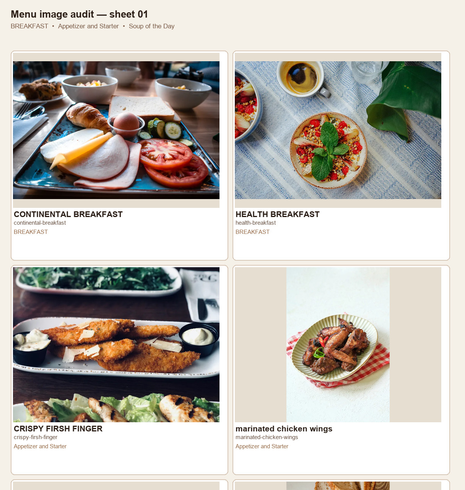

# Menu image audit — sheet 01

Categories: BREAKFAST  •  Appetizer and Starter  •  Soup of the Day

## Products

### BREAKFAST

**CONTINENTAL BREAKFAST** (`continental-breakfast`) — [source](https://www.pexels.com/photo/breakfast-on-a-tray-13900903/) — Pham Ngoc Anh

**HEALTH BREAKFAST** (`health-breakfast`) — [source](https://www.pexels.com/photo/flat-lay-shot-of-food-and-coffee-on-table-9928177/) — Dasha Klimova

### Appetizer and Starter

**CRISPY FIRSH FINGER** (`crispy-firsh-finger`) — [source](https://www.pexels.com/photo/fish-fillet-2213257/) — Key Notez

**marinated chicken wings** (`marinated-chicken-wings`) — [source](https://www.pexels.com/photo/delicious-indonesian-grilled-chicken-wings-37126785/) — Tiya Nh

### Soup of the Day

**Chicken Coconut soup** (`chicken-coconut-soup`) — [source](https://www.pexels.com/photo/delicious-tom-kha-gai-thai-coconut-soup-35049889/) — UNDO KIM

**Creamy mushroom soup** (`creamy-mushroom-soup`) — [source](https://www.pexels.com/photo/a-bowl-of-mushroom-soup-5419047/) — Polina Tankilevitch

**mixed vegetable soup** (`mixed-vegetable-soup`) — [source](https://www.pexels.com/photo/soups-with-vegetables-16811680/) — fajri nugroho
