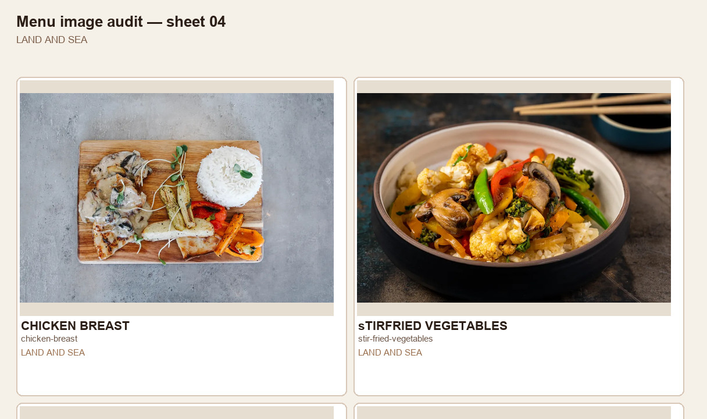

# Menu image audit — sheet 04

Categories: LAND AND SEA

## Products

### LAND AND SEA

**CHICKEN BREAST** (`chicken-breast`) — [source](https://www.pexels.com/photo/meat-and-rice-5192403/) — Maor Attias

**sTIRFRIED VEGETABLES** (`stir-fried-vegetables`) — [source](https://www.pexels.com/photo/rice-bowl-with-mixed-vegetable-toppings-10695966/) — Skyler Ewing

**MARINATED HALF GRILLED CHICKEN** (`marinated-half-grilled-chicken`) — [source](https://www.pexels.com/photo/delicious-grilled-chicken-dinner-with-fries-and-salad-30268596/) — Vano Pereira

**MARINATED BEEF RIBS** (`marinated-beef-ribs`) — [source](https://www.pexels.com/photo/delicious-barbecue-ribs-with-salad-and-fries-32538759/) — Cristhian David Duarte

**iNDIAN VEGEtABLE CURRY** (`indian-vegetable-curry`) — [source](https://www.pexels.com/photo/a-yellow-bowl-filled-with-rice-and-vegetables-18510422/) — Markus Winkler

**NILED PERCH FISH FILLET** (`nile-perch-fish-fillet`) — [source](https://www.pexels.com/photo/food-on-white-plate-8992936/) — I Own My Food Art
