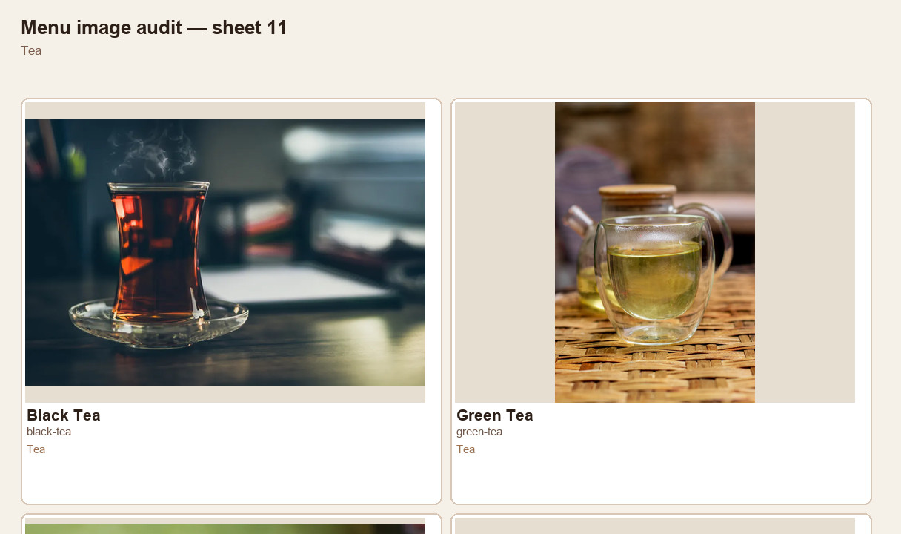

# Menu image audit — sheet 11

Categories: Tea

## Products

### Tea

**Black Tea** (`black-tea`) — [source](https://www.pexels.com/photo/close-up-photo-of-steaming-black-tea-in-glass-1493080) — Hasan Albari

**Green Tea** (`green-tea`) — [source](https://www.pexels.com/photo/double-walled-glass-cup-with-green-tea-on-wicker-surface-29050880/) — Natalia Sevruk

**African Tea** (`african-tea`) — [source](https://www.pexels.com/photo/tea-cup-with-teapot-12698360/) — Lorena Martínez

**Lemon Tea** (`lemon-tea`) — [source](https://www.pexels.com/photo/close-up-shot-of-a-lemon-tea-9303149/) — Alesia Talkachova

**Ginger Tea** (`ginger-tea`) — [source](https://www.pexels.com/photo/cup-of-ginger-tea-with-cinnamon-sticks-6962419/) — Cup of Couple

**Spicy Tea** (`spicy-tea`) — [source](https://www.pexels.com/photo/cup-of-masala-chai-on-table-5946623/) — Charlotte May

**Iced Tea** (`iced-tea`) — [source](https://www.pexels.com/photo/a-glass-of-iced-tea-with-lemon-slices-12033562/) — deno wang

**Peach & Elderflower** (`peach-and-elderflower`) — [source](https://www.pexels.com/photo/photo-of-a-drink-beside-a-sliced-peach-9230288/) — Tanner Barrott
